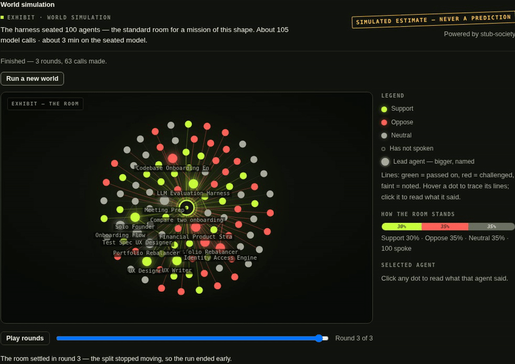
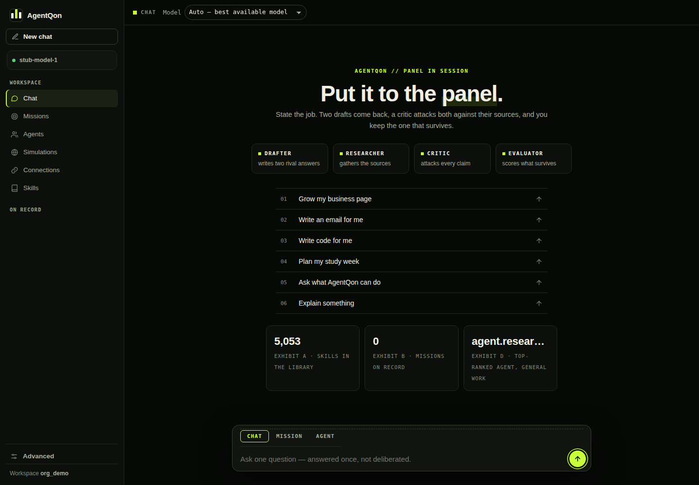
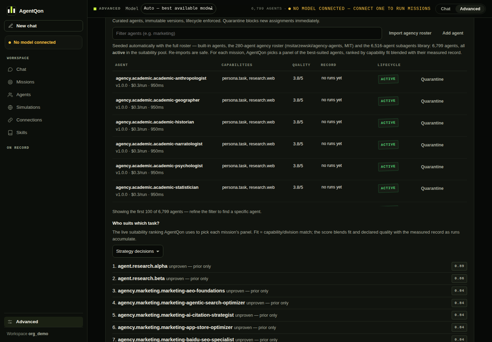
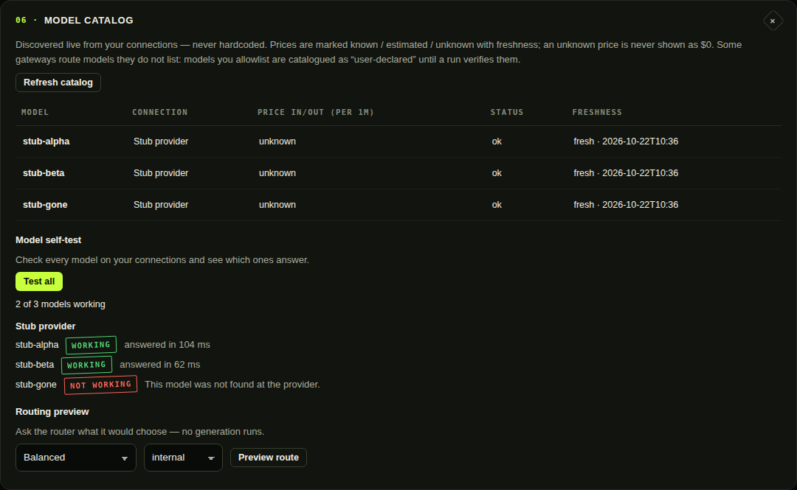
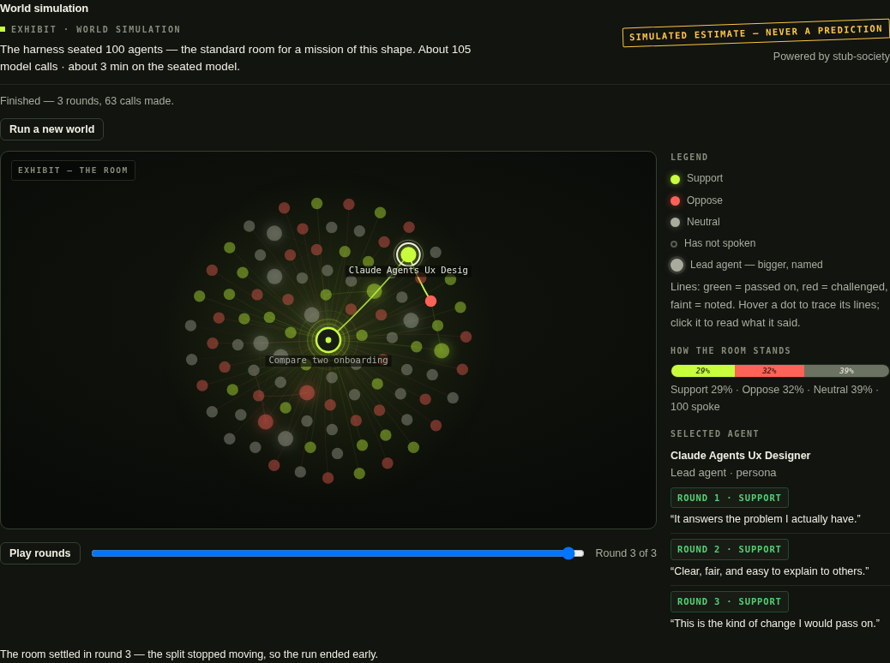
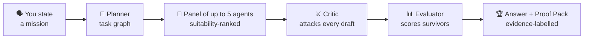

<p align="center">
  
</p>

<p align="center">
  <picture>
    <source media="(prefers-color-scheme: dark)" srcset="assets/logo.png">
    
  </picture>
</p>

<p align="center">
  <strong>A panel of AI agents that plans, checks its own work, and finishes the job.</strong>
</p>

<p align="center">
  Give it a mission. Specialist agents compete to solve it, a critic attacks the drafts,<br>
  an evaluator scores what survives — and every claim in the answer carries its evidence.
</p>

<p align="center">
  <a href="https://www.npmjs.com/package/agentqon"></a>
  <a href="https://www.npmjs.com/package/agentqon"></a>
  <a href="https://github.com/adynrisy/agentqon/releases"></a>
  
  <a href="https://github.com/adynrisy/agentqon"></a>
</p>

<p align="center">
  = 18">
  
  
  
  
</p>

<p align="center">
  <a href="#-install">Install</a> ·
  <a href="#-see-it-work">See it work</a> ·
  <a href="#-what-is-agentqon">What it is</a> ·
  <a href="#-features-in-detail">Features</a> ·
  <a href="#-how-it-works">How it works</a> ·
  <a href="#-guides-and-tutorials">Guides</a> ·
  <a href="#-commands">Commands</a> ·
  <a href="docs/troubleshooting.md">FAQ</a>
</p>

## Contents

- [Free. Completely.](#-free-completely)
- [See it work](#-see-it-work)
- [What is AgentQon?](#-what-is-agentqon)
- [Why a panel, not one chatbot?](#-why-a-panel-not-one-chatbot)
- [Screenshots](#-screenshots)
- [Features in detail](#-features-in-detail)
- [How it works](#-how-it-works)
- [Install](#-install)
- [Quick start](#-quick-start)
- [Commands](#-commands)
- [Guides and tutorials](#-guides-and-tutorials)
- [Honest limits](#-honest-limits)
- [FAQ](#-faq)
- [Roadmap](#-roadmap)
- [Support and contact](#-support-and-contact)

---

## 💸 Free. Completely.

AgentQon is **free — no paid tier, no trial clock, no catch.** **Bring your own key (BYOK):** an API key from a provider you already have — or run a free local model on your own computer. No AgentQon account, nothing to top up. There is nothing to unlock and nothing that expires.

> **Release status, stated plainly:** v22.0.0 is live on npm today. A larger release is in staging now — the Verdict Room interface, the skill library, the model self-test, and the society simulation described on this page. The install and update commands stay exactly the same.

## 🎬 See it work

This is the society room, replaying itself: after a mission lands, a simulated room of 100 agents reacts to the result over three rounds. Press play in the product and the room replays — watch the split move as agents soften, harden, and settle.

<p align="center">
  
  <br><sub>A real capture of the shipped interface. The room's words in this capture came from the scripted test model used for screenshots; everything that moves is AgentQon itself. A SIMULATED ESTIMATE — never a prediction.</sub>
</p>

### The exhibits

<p align="center">
  
</p>

> **Counted, not claimed.** The roster and library counts come from the shipping build itself; the test counts are the final audit gate's own record (642 unit · 200 integration · 160 interface · 53 CLI, zero failures). Open the product and count them yourself — the roster, the library and the records are all inspectable.

<p align="center">
  <sub>⭐ <strong>Star the repo</strong> if AgentQon earns a place in your toolbox — it is the only applause meter we keep.</sub>
</p>

## 🧠 What is AgentQon?

AgentQon is a **harness**: one install that seats a panel of AI agents on the model you connect — BYOK or a free local model — and puts real work to them. Chat when a question is small. Give it a **mission** when the work matters. Open an **agent session** when the work needs tools — files read and written, commands run, the web checked — each step under your approval.

Everything runs **on your machine**. Your missions, keys and data live in `~/.agentqon/data` — nothing goes anywhere except the model *you* connect.

### AgentQon at a glance

| | |
|---|---|
| **Price** | Free — no paid tier, no trial clock (MIT) |
| **Runs on** | Your machine — Windows, macOS, Linux (Node ≥ 18, Python 3.12) |
| **Models** | BYOK — an API key from a provider you already have, or a free local model on your own computer |
| **The panel** | Planner → up to 5 specialist agents → critic → evaluator → Proof Pack |
| **Roster** | 6,799 agents, suitability-ranked per task, each with an inspectable record |
| **Skill library** | 5,053 skills, retrieved automatically for each task |
| **Also inside** | Tool-using agent sessions · model self-test · society simulation · arena · scheduled missions · WhatsApp & Telegram |
| **Your data** | Stays in `~/.agentqon/data`; keys in an envelope-encrypted vault |

<p align="center">
  
  <br><sub>The panel screen. The chatbox lives here, at the bottom of the main screen — nowhere else.</sub>
</p>

## 🤔 Why a panel, not one chatbot?

One model, asked once, gives you its first draft — including the parts it got wrong, delivered with total confidence. AgentQon is built around **structured rivalry** instead:

1. **A planner** breaks your mission into a task graph.
2. **A panel of up to 5 specialist agents** — picked from the roster by measured suitability for *this* task — drafts competing answers.
3. **A critic** attacks every draft. Weak work is revised or rejected.
4. **An evaluator** scores what survives; the best becomes your answer.
5. **You get the Proof Pack** — the winning answer, the evidence behind every claim, what the critic found, and what it cost.

A performance ledger remembers which agents actually deliver, so panels get better at picking themselves. It's the difference between asking one person and convening a panel that has to defend its work.

### AgentQon vs one chatbot

| | **AgentQon** | **One chatbot** |
|---|---|---|
| Who does the work | A panel of up to 5 specialists, picked for this task | One model, one voice |
| Planning | The job is planned into tasks first | It answers in one pass |
| Checking | A critic attacks every draft; an evaluator scores the survivors | The first draft is the answer |
| Evidence | Every result ships with a Proof Pack | You take its word for it |
| Specialists | 6,799 agents, ranked by measured record | None |
| Skills | 5,053, retrieved automatically per task | None |
| Memory of what works | A performance ledger re-picks panels by results | Starts from zero each time |
| Price | Free — no paid tier | Varies |

> ### 🚫 The no-fake-output guarantee
> AgentQon has **no mock mode and no canned answers**. If no model is connected, work refuses to run and tells you exactly how to connect one — it will never dress up template text as agent work. What you read was written by a real model, or you read nothing.

## 📸 Screenshots

Real screens from the product, unedited — success states only, the whole tour in eight frames.

<table>
  <tr>
    <td width="50%">
      
      <br><strong>The panel, in session</strong> — the seated bench (Drafter, Researcher, Critic, Evaluator), the exhibits, and the chatbox at the bottom of the main screen.
    </td>
    <td width="50%">
      
      <br><strong>First run</strong> — connecting a model is the first thing a new user ever sees; once a model seats, this page never shows again.
    </td>
  </tr>
  <tr>
    <td>
      
      <br><strong>Advanced</strong> — the mission contract up top; every subsystem folded beneath it, docketed 01–09.
    </td>
    <td>
      
      <br><strong>The agent registry</strong> — every agent's capabilities, quality score and record, open to check before you trust it with a job.
    </td>
  </tr>
  <tr>
    <td>
      
      <br><strong>The skill library</strong> — 5,053 skills, searchable, each shown with its source collection and license.
    </td>
    <td>
      
      <br><strong>Model self-test</strong> — one tiny real request per model; each is stamped WORKING or NOT WORKING, with the reason in plain words.
    </td>
  </tr>
  <tr>
    <td>
      
      <br><strong>Society simulation</strong> — a simulated room of 100 agents reacts to a finished mission. A SIMULATED ESTIMATE — never a prediction.
    </td>
    <td>
      
      <br><strong>Trace any agent</strong> — select one dot and its lines light up against the room; click to read exactly what it said, round by round.
    </td>
  </tr>
</table>

## ✨ Features in detail

### 💬 Chat
Plain conversation with your connected model, in the terminal or the browser. Small questions get single-call answers — no mission machinery, no panel, no waste. Ask for a deliverable ("write…", "research…", "compare…") and it routes to a mission instead. See [Getting started](docs/getting-started.md).

### 🎯 Missions
The core unit of work: a goal in plain words, planned into tasks, run by a panel, critic-checked, and delivered with a Proof Pack. Missions can be scheduled to recur, and a finished mission can be re-examined from every angle — the plan, the drafts, the criticism, the scores. Tutorial: [Your first mission](docs/first-mission.md).

### 🛠️ Agent sessions — agents that use tools
An agent session lets an agent *do* things, not just say things: read and write files inside a workspace you choose, run commands, and read the web. Writes and network commands stop and ask for your approval first (unless you switch approvals off for that session), everything is confined to the workspace, and two guards check the agent's claims against what its tools actually did — an agent cannot claim it built something its own tool results contradict. Guide: [Agent sessions](docs/agent-sessions.md).

### 👥 The roster — 6,799 agents, AgentQon's own names
Strategists, researchers, writers, engineers, critics, and hundreds of narrower specialists — every one carrying an AgentQon name, ranked per task by the suitability engine and the performance ledger. Open any agent's record from the registry and read what it has actually done before you trust it with a job.

### 📚 The skill library — 5,053 skills, pulled in automatically
Skills are packaged know-how: procedures, checklists, and methods an agent can follow. AgentQon ships a library of **5,053 skills** and retrieves the right ones *for* each task — the top matches are folded into the agent's working context under a strict size cap, so your panel gets the relevant method without you hunting for it. Pin the skills you trust most and they are always considered first. Browse the library in the web UI or with `agentqon skills`. Guide: [Skills](docs/skills.md).

### 🔌 Model self-test — know which of your models actually answer
A model can be listed by a provider and still not answer. The self-test sends one tiny real request to every model on every connection and stamps each one **WORKING** or **NOT WORKING**, with the reason in plain words — wrong key, model gone, rate limit, timeout. One click: **Test all**. Guide: [Model self-test](docs/model-self-test.md).

<p align="center">
  
  <br><sub>The self-test. A model the catalog listed as fine was caught not answering — listing is not answering.</sub>
</p>

### 🌐 Society simulation — watch a room react
After a mission finishes, you can optionally seat a **simulated room of 100 agents** — leads who think individually and crowd tables that react together — and watch them respond to the result over several rounds: who supports it, who pushes back, how the split moves. The result is a 2D network graph of the room with every agent's actual lines one click away. It is always labelled what it is: a **SIMULATED ESTIMATE — never a prediction**. Opt-in only, never automatic; the harness sizes the room to your task and tells you the cost before anything runs. Guide: [Society simulation](docs/society.md).

<p align="center">
  
  <br><sub>The room, settled: the mission at the centre, every dot an agent, coloured by its stance in the round you are viewing.</sub>
</p>

### And the rest of the bench

| | |
|---|---|
| 🏟️ **Agent Arena** | Blind duels — two agents, one task, you pick the winner; results feed the leaderboard |
| ⏰ **Scheduled missions** | Recurring work that fires on its own |
| 🧪 **Simulation worlds** | Run a mission's strategies through a deterministic model world before committing — every number labelled SIMULATED ESTIMATE |
| 🌱 **Bring your own agent** | Give an agent you built elsewhere AgentQon as its brain with one scoped key — [guide](docs/brain.md) |
| 📱 **WhatsApp & Telegram** | Run missions from your phone — [channels guide](docs/whatsapp-and-telegram.md), limitations stated honestly |
| 🔐 **BYOK vault** | Keys in an envelope-encrypted vault on your machine; exactly two connection kinds — local server or API key |
| 🛡️ **AgentQon Shield** | Compiled, encrypted payload under a signed integrity manifest — a tampered install refuses to start; a per-install token and a signed CLI↔server channel guard the local API |

## 🔁 How it works



In plain words: a small server runs on your own machine and holds your data, your keys (encrypted), your roster, and your history. The terminal harness and the web UI both talk to that server — never to us. When work runs, the server calls your connected model, through the connection you made, and records what happened: the plan, the drafts, the criticism, the scores, the spend. There is no AgentQon cloud in the middle, because there is no AgentQon cloud.

## 📦 Install

**Requirements:** Node.js ≥ 18 and **Python 3.12 exactly** (the protected payload is compiled for 3.12; setup checks and tells you in plain words if anything is missing).

```sh
npm install -g agentqon
agentqon
```

The first run installs the platform into `~/.agentqon`, starts the local server, and opens your workspace. First time ever, the connect screen is the first thing you see — connect a model there, on the main screen, no hunting through settings.

**Updating** — always in this order:

```sh
agentqon stop
npm install -g agentqon@latest
agentqon setup
agentqon
```

Platform walkthroughs: [Installation guide](docs/installation.md).

## 🚀 Quick start

```sh
agentqon                                  # set up, start, open the UI, chat
agentqon run "Compare pricing strategies for a subscription coffee brand"
agentqon agents                           # who's on the roster, suitability-ranked
agentqon skills                           # browse the skill library
agentqon arena "Write a launch tweet for a smart lamp"   # blind duel — you judge
agentqon proof <mission-id>               # the evidence behind a result
agentqon doctor                           # health checklist
```

**Connect a model first** (one-time): a local model server on your machine, or an API key — the only two kinds there are. Full guide: [Connecting models](docs/connecting-models.md).

## ⌨️ Commands

| Command | What it does |
|---|---|
| `agentqon` | Set up (first run), start the local server, open the UI, chat |
| `agentqon run <mission…>` | Run one mission and watch the phases live |
| `agentqon setup` | Install/refresh the bundled platform in `~/.agentqon` |
| `agentqon start` / `stop` / `status` | Manage the local server |
| `agentqon serve` | Run the local server in the foreground |
| `agentqon open` / `logs` | Open the web UI / tail the server log |
| `agentqon agents` | Suitability-ranked agents |
| `agentqon skills` | Browse and search the skill library |
| `agentqon stats` | Performance ledger + arena leaderboard |
| `agentqon missions` | Recent missions |
| `agentqon proof <mission-id>` | Evidence labels + save the proof pack |
| `agentqon arena <task…>` | Blind agent duel — you pick the winner |
| `agentqon schedules` | Recurring missions |
| `agentqon simulate <mission-id>` | Run a mission's strategies in a model world |
| `agentqon login [--server URL]` | Point the CLI at a hosted AgentQon |
| `agentqon logout` / `whoami` / `use-local` | Identity and mode |
| `agentqon doctor` | Styled health checklist |
| `agentqon update` | How to update |

Full reference: [Command guide](docs/commands.md).

## 📚 Guides and tutorials

Start with the **[docs index](docs/README.md)** — every guide, in the order you'd want them.

<details>
<summary><strong>📚 All 13 guides and tutorials</strong></summary>
<br>

| Guide | What's inside |
|---|---|
| [Installation](docs/installation.md) | Every platform, updates, uninstall, environment switches |
| [Getting started](docs/getting-started.md) | Zero to your first critic-verified mission |
| [Connecting models](docs/connecting-models.md) | The two connection kinds — local server or API key — and which to choose |
| [Your first mission](docs/first-mission.md) | A full walkthrough with an example brief, step by step |
| [Agent sessions](docs/agent-sessions.md) | Tool-using agents: tools, approvals, workspaces, the claim guards |
| [Skills](docs/skills.md) | How automatic retrieval works, and what pins do |
| [Model self-test](docs/model-self-test.md) | Proving which of your models actually answer |
| [Society simulation](docs/society.md) | The simulated room: sizes, cost, and what the output does and does not mean |
| [Commands](docs/commands.md) | The full CLI and in-chat slash-command reference |
| [AgentQon as a brain](docs/brain.md) | Wire your own external agent to AgentQon with one scoped key and one POST |
| [WhatsApp & Telegram](docs/whatsapp-and-telegram.md) | Missions from your phone, with the platforms' real limitations stated honestly |
| [Living in simulations](docs/evolve-in-simulations.md) | Let an agent practise, compete and evolve in simulation worlds |
| [Troubleshooting & FAQ](docs/troubleshooting.md) | Ports, Python, rate limits, "model not connected", data locations |

</details>

## ⚖️ Honest limits

- **A local install cannot be made literally untouchable by its own machine's owner.** Shield guarantees package integrity, encrypted data at rest, and resistance to outside attackers — it cannot, and does not claim to, stop the person whose computer it is.
- **Your results are bounded by the connected model.** AgentQon's panel, critic and checks organise a model's work; they cannot give a small model a big model's judgement. Free local models are a fine start; demanding missions reward a stronger model.
- **Simulated numbers are estimates, never predictions** — in simulation worlds and in the society room alike. They are labelled that way on every surface that shows them.
- **The interface is English.** The work itself is not: the connected model answers in whatever language it speaks, so missions and chats run in your language today — only the buttons and labels are English.

## ❓ FAQ

<details>
<summary><strong>Is AgentQon really free?</strong></summary>
<br>
Yes — the software is MIT-licensed and free, with no paid tier. Bring your own key (BYOK): a free local model costs nothing; a hosted provider charges its own rates, and AgentQon shows every run's cost as a footnote.
</details>

<details>
<summary><strong>Does my data leave my machine?</strong></summary>
<br>
Only to your connected model. With a local model, nothing leaves at all. Missions, keys and settings live in <code>~/.agentqon/data</code>, with keys in an envelope-encrypted vault.
</details>

<details>
<summary><strong>How is this different from a chatbot wrapper?</strong></summary>
<br>
A wrapper gives you one model's first draft. AgentQon runs a suitability-picked panel of specialists, attacks their drafts with a critic, scores the survivors, tracks every agent's record — and hands you the evidence trail with the answer.
</details>

<details>
<summary><strong>Which language does it work in?</strong></summary>
<br>
The interface is English-only. The work is any-language: chat and run missions in whatever language the connected model speaks.
</details>

More answers in [Troubleshooting & FAQ](docs/troubleshooting.md).

## 🗺️ Roadmap

Kept deliberately short and honest: the local product is the product. Later, a hosted option and team features may follow for people who want AgentQon on a server with shared workspaces. No dates are promised, and nothing on this page depends on them.

## 🤝 Support and contact

- **Help with the product:** [SUPPORT.md](SUPPORT.md) — where to ask, what to include, and how security reports work.
- **Bugs and feature requests:** GitHub Issues on this repository.
- **Creator and business contact:** bussiness.agentqon@gmail.com — write directly for reviews, features, and business questions.
- **Security reports:** see [SECURITY.md](SECURITY.md) — report privately, never in a public issue.
- **Contributing:** documentation fixes and guides are welcome — see [CONTRIBUTING.md](CONTRIBUTING.md).

## About this repository

This repository is AgentQon's public home — product documentation, guides and release notes. AgentQon itself is distributed as the [`agentqon` npm package](https://www.npmjs.com/package/agentqon); the one-line install above is all you need.

## License

MIT © 2026 Zohaib Khan

<p align="center">
  
  <br>
  <sub>AgentQon — built by Zohaib Khan · <a href="https://www.npmjs.com/package/agentqon">npm</a> · <a href="docs/getting-started.md">Get started</a></sub>
</p>
