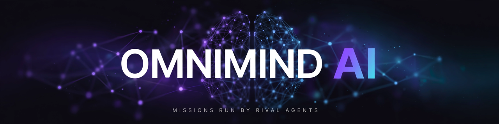
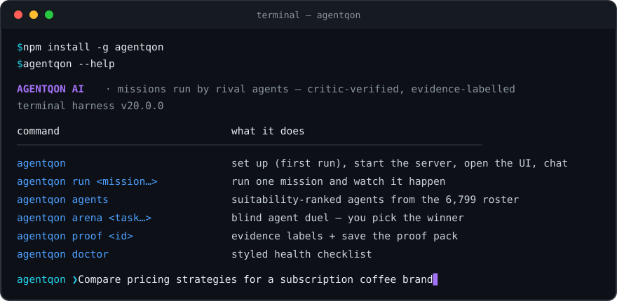
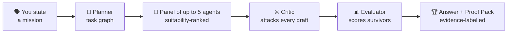

<p align="center">
  
</p>

<p align="center">
  
</p>

<p align="center">
  <strong>Give it a mission. A panel of specialist agents competes to solve it, a critic attacks the drafts,<br>
  an evaluator scores what survives — and every claim in the answer carries its evidence.</strong>
</p>

<p align="center">
  <a href="https://www.npmjs.com/package/omnimind-ai"></a>
  <a href="https://www.npmjs.com/package/omnimind-ai"></a>
  <a href="https://github.com/adynrisy/omnimind-ai/releases"></a>
  <a href="https://github.com/adynrisy/omnimind-ai"></a>
  
</p>

<p align="center">
  = 18">
  
  
  
</p>

<p align="center">
  <a href="#-install">Install</a> ·
  <a href="#-quick-start">Quick start</a> ·
  <a href="#-how-a-mission-works">How it works</a> ·
  <a href="#-guides">Guides</a> ·
  <a href="#-commands">Commands</a> ·
  <a href="docs/troubleshooting.md">FAQ</a>
</p>

---

<p align="center">
  
</p>

## 🧠 What is OmniMind AI?

Most "multi-agent" tools are one model talking to itself. OmniMind is built around **structured rivalry**: instead of asking a single model once, it convenes a panel of specialist agents — chosen from a roster of **6,668 agents** by measured suitability for your task — and makes them *compete*. A critic attacks every draft. An evaluator scores the survivors. A performance ledger remembers who actually performs.

Everything runs **on your machine**. Your missions, keys and data live in `~/.omnimind/data` — nothing goes anywhere except the model *you* connect.

## 🔁 How a mission works



1. **You state a mission** — strategy, research, writing, code, a plan, a question.
2. **A planner** classifies it and breaks it into a task graph.
3. **A panel of up to 5 agents** drafts competing solutions in parallel.
4. **A critic** attacks every draft; weak work is revised or rejected.
5. **An evaluator** scores what survives; the best becomes your answer.
6. **You get the Proof Pack** — the winning draft, the evidence behind every claim, what the critic found, and what it cost.

> ### 🚫 The no-fake-output guarantee
> OmniMind has **no mock mode and no canned answers**. If no model is connected, a mission refuses to run and tells you exactly how to connect one — it will never dress up template text as agent work. What you read was written by a real model, or you read nothing.

## ✨ Features

| | |
|---|---|
| 🖥️ **Terminal harness + web UI in one install** | Chat-first in the terminal and the browser; the full dashboard lives one click away |
| 👥 **6,668-agent roster** | 280 curated agency specialists + 6,385 from the open subagents library — strategists, researchers, writers, engineers, critics, ranked per task by live performance data |
| 🎯 **Suitability panels** | Up to 5 best-fit agents per mission; no two task types get the same panel by default |
| ⚔️ **Critic-verified output** | Every candidate is attacked before it can win |
| 📦 **Proof Packs** | Exportable evidence trail for any mission |
| 🏟️ **Agent Arena** | Blind duels — two agents, one task, you pick the winner; results feed the leaderboard |
| ⏰ **Scheduled missions** | Recurring work that fires on its own |
| 🌍 **Simulation worlds** | Run a mission's strategies through a deterministic model world before committing |
| 📱 **WhatsApp & Telegram front doors** | Run missions from your phone — see the [channels guide](docs/whatsapp-and-telegram.md) |
| 🔐 **Budgets & BYOK vault** | Encrypted per-tenant key storage and spend caps |
| 🛡️ **OmniMind Shield** (v20.2) | Compiled, encrypted payload with a signed integrity manifest — a tampered install refuses to start; per-install local token and an HMAC-signed CLI↔server channel protect the local API |

## 📦 Install

**Requirements:** Node.js ≥ 18 and **Python 3.12 exactly**. The current release's Shield-protected payload is compiled for Python 3.12, so setup refuses other Python versions (3.11, 3.13, …) with a plain message telling you to install 3.12. (On first run, OmniMind checks both and tells you exactly what to install if anything is missing.)

```sh
npm install -g omnimind-ai
```

Then:

```sh
omnimind
```

The first run installs the bundled platform into `~/.omnimind`, builds its private Python environment, starts the local server on http://127.0.0.1:8000 (or the next free port) and opens your workspace.

Platform walkthroughs: [Installation guide](docs/installation.md).

## 🚀 Quick start

```sh
omnimind                                  # set up, start, open the UI, chat
omnimind run "Compare pricing strategies for a subscription coffee brand"
omnimind agents                           # who's on the roster, suitability-ranked
omnimind arena "Write a launch tweet for a smart lamp"   # blind duel — you judge
omnimind proof <mission-id>               # the evidence behind a result
omnimind doctor                           # health checklist
```

**Connect a model first** (one-time): Ollama is auto-detected, or add a provider key in the UI's Connections panel. All four routes — BYOK, environment endpoint, OmniRoute sidecar, Ollama — are in [Connecting models](docs/connecting-models.md).

Full walkthrough: [Getting started](docs/getting-started.md).

## ⌨️ Commands

| Command | What it does |
|---|---|
| `omnimind` | Set up (first run), start the local server, open the UI, chat |
| `omnimind run <mission…>` | Run one mission and watch the phases live |
| `omnimind setup` | Install/refresh the bundled platform in `~/.omnimind` |
| `omnimind start` / `stop` / `status` | Manage the local server |
| `omnimind serve` | Run the local server in the foreground |
| `omnimind open` / `logs` | Open the web UI / tail the server log |
| `omnimind agents` | Suitability-ranked agents |
| `omnimind stats` | Performance ledger + arena leaderboard |
| `omnimind missions` | Recent missions |
| `omnimind proof <mission-id>` | Evidence labels + save the proof pack |
| `omnimind arena <task…>` | Blind agent duel — you pick the winner |
| `omnimind schedules` | Recurring missions |
| `omnimind simulate <mission-id>` | Run a mission's strategies in a model world |
| `omnimind login [--server URL]` | Point the CLI at a hosted OmniMind |
| `omnimind logout` / `whoami` / `use-local` | Identity and mode |
| `omnimind doctor` | Styled health checklist |
| `omnimind update` | How to update |

Full reference: [Command guide](docs/commands.md).

## 📚 Guides

| Guide | What's inside |
|---|---|
| [Installation](docs/installation.md) | Every platform, updates, uninstall, environment switches |
| [Getting started](docs/getting-started.md) | Your first mission, end to end — proof packs, arena, schedules, simulation |
| [Connecting models](docs/connecting-models.md) | BYOK keys, env endpoints, OmniRoute, Ollama — and which to choose |
| [Commands](docs/commands.md) | The full CLI and in-chat slash-command reference |
| [WhatsApp & Telegram](docs/whatsapp-and-telegram.md) | Missions from your phone, with the platforms' real limitations stated honestly |
| [Troubleshooting & FAQ](docs/troubleshooting.md) | Ports, Python, "model not connected", data locations |

## ❓ FAQ

<details>
<summary><strong>Is OmniMind free?</strong></summary>
<br>
The software is MIT-licensed and free. You bring the model: a local Ollama model costs nothing; hosted providers charge their own rates, and OmniMind shows every run's cost as a footnote.
</details>

<details>
<summary><strong>Does my data leave my machine?</strong></summary>
<br>
Only to the model you connected. With Ollama, nothing leaves at all. Missions, keys and settings live in <code>~/.omnimind/data</code>, with keys in an envelope-encrypted vault.
</details>

<details>
<summary><strong>How is this different from a chatbot wrapper?</strong></summary>
<br>
A wrapper gives you one model's first draft. OmniMind runs a suitability-picked panel of specialists, attacks their drafts with a critic, scores the survivors, tracks every agent's record — and hands you the evidence trail with the answer.
</details>

More answers in [Troubleshooting & FAQ](docs/troubleshooting.md).

## 🤝 Contributing

Bug reports, feature requests and documentation fixes are welcome — see [CONTRIBUTING.md](CONTRIBUTING.md). Security reports: see [SECURITY.md](SECURITY.md).

## About this repository

This repository is OmniMind AI's public home — product documentation, guides and release notes. OmniMind itself is distributed as the [`omnimind-ai` npm package](https://www.npmjs.com/package/omnimind-ai); the one-line install above is all you need.

## License

MIT © 2026 Zohaib Khan

<p align="center">
  
  <br>
  <sub>OmniMind AI — built by Zohaib Khan · <a href="https://www.npmjs.com/package/omnimind-ai">npm</a> · <a href="docs/getting-started.md">Get started</a></sub>
</p>
