<p align="center">
  
</p>

<p align="center">
  <picture>
    <source media="(prefers-color-scheme: dark)" srcset="assets/logo.png">
    
  </picture>
</p>

<p align="center">
  <strong>A panel of AI agents that plans, checks its own work, and finishes the job.</strong>
</p>

<p align="center">
  Give it a mission. Specialist agents compete to solve it, a critic attacks the drafts,<br>
  an evaluator scores what survives — and every claim in the answer carries its evidence.
</p>

<p align="center">
  <a href="https://www.npmjs.com/package/agentqon"></a>
  <a href="https://www.npmjs.com/package/agentqon"></a>
  <a href="https://github.com/adynrisy/agentqon/releases"></a>
  
  <a href="https://github.com/adynrisy/agentqon"></a>
</p>

<p align="center">
  = 18">
  
  
  
  
</p>

<p align="center">
  <code><strong>&nbsp;npm install -g agentqon&nbsp;</strong></code>
  <br><sub>One command installs it — then just run <code>agentqon</code>. Free forever. No account, no signup.</sub>
</p>

<p align="center">
  <a href="#-install">Install</a> ·
  <a href="#-see-it-work">See it work</a> ·
  <a href="#-what-is-agentqon">What it is</a> ·
  <a href="#-features-in-detail">Features</a> ·
  <a href="#-how-it-works">How it works</a> ·
  <a href="#-guides-and-tutorials">Guides</a> ·
  <a href="#-commands">Commands</a> ·
  <a href="docs/troubleshooting.md">FAQ</a>
</p>

<p align="center">
  
</p>

## Contents

- [Free. Completely.](#-free-completely)
- [See it work](#-see-it-work)
- [What is AgentQon?](#-what-is-agentqon)
- [Why a panel, not one chatbot?](#-why-a-panel-not-one-chatbot)
- [Features, drawn in motion](#-the-features-drawn-in-motion)
- [Features in detail](#-features-in-detail)
- [How it works](#-how-it-works)
- [Install](#-install)
- [Quick start](#-quick-start)
- [Commands](#-commands)
- [Guides and tutorials](#-guides-and-tutorials)
- [FAQ](#-faq)
- [Roadmap](#-roadmap)
- [Support and contact](#-support-and-contact)
- [Honest limits](#-honest-limits)
- [Put it to the panel.](#-put-it-to-the-panel)

---

## 💸 Free. Completely.

AgentQon is **free — no paid tier, no trial clock, no catch.** **Bring your own key (BYOK):** an API key from a provider you already have — or run a free local model on your own computer: **free on localhost, zero cost forever.** No AgentQon account, no signup, nothing to top up. There is nothing to unlock and nothing that expires.

> **Release status, stated plainly:** v22.6.0 is live on npm today — the Muse-mirror activity panel, composer file attachments, and the societies list fix, on top of everything before it: **v22.2.0** (the Extended Library), **v22.3.0** (model combos, provider presets, the new page map), **v22.4.0** (live world progress) and **v22.5.0** (free-roam — your machine, under your law) — all live, all described on this page. v22.7.0 is staged and awaits the owner's approval to go live: the merged redesign UI plus the four v22.6.0 bug fixes. The install and update commands stay exactly the same.

## 📱 Android app

AgentQon also runs on your phone — the full harness, not a
companion app: chat, missions, agents, simulations, skills, and the
app-wide activity feed, with the computer character at the top of
the panel.

The app is distributed as a release build only — its source code
is not published here. Android builds publish on the releases page:

[AgentQon Android releases](https://github.com/adynrisy/agentqon/releases)

Install: uninstall any older AgentQon app first (each build signs
with a fresh debug key, so Android blocks installing over the old
one), then install the downloaded APK. Requires 64-bit Android
(arm64), Android 8.0 or newer.

## 🎬 See it work

The whole story, drawn in one loop: you state a mission, the panel plans it and works it — drafts checked, verdict stamped, Proof Pack attached — and then the finished work meets the society room, where a hundred simulated agents react to it in waves.

<p align="center">
  
  <br><sub>A drawn explainer of a mission's full journey — panel first, Proof Pack second, the room last. A SIMULATED ESTIMATE — never a prediction.</sub>
</p>

### The exhibits

<p align="center">
  
</p>

> **Counted, not claimed.** The roster and library counts come from the shipping build itself; the test counts are the final audit gate's own record (642 unit · 200 integration · 160 interface · 53 CLI, zero failures). Open the product and count them yourself — the roster, the library and the records are all inspectable.

<p align="center">
  <sub>⭐ <strong>Star the repo</strong> if AgentQon earns a place in your toolbox — it is the only applause meter we keep.</sub>
</p>

## 🧠 What is AgentQon?

AgentQon is a **harness**: one install that seats a panel of AI agents on the model you connect — BYOK or a free local model — and puts real work to them. Chat when a question is small. Give it a **mission** when the work matters. Open an **agent session** when the work needs tools — files read and written, commands run, the web checked — each step under your approval.

Everything runs **on your machine**. Your missions, keys and data live in `~/.agentqon/data` — nothing goes anywhere except the model *you* connect.

### AgentQon at a glance

| | |
|---|---|
| **Price** | Free — no paid tier, no trial clock (MIT) |
| **Runs on** | Your machine — Windows, macOS, Linux (Node ≥ 18, Python 3.12) |
| **Models** | BYOK — an API key from a provider you already have, or a free local model on your own computer |
| **The panel** | Planner → up to 5 specialist agents → critic → evaluator → Proof Pack |
| **Roster** | 6,799 agents, suitability-ranked per task, each with an inspectable record |
| **Skill library** | 4,840 skills in the box — 5,053 with the free Extended Library — retrieved automatically for each task |
| **Also inside** | Tool-using agent sessions · model self-test · model combos · provider presets · society simulation · arena · scheduled missions · WhatsApp & Telegram |
| **Your data** | Stays in `~/.agentqon/data`; keys in an envelope-encrypted vault |

## 🤔 Why a panel, not one chatbot?

One model, asked once, gives you its first draft — including the parts it got wrong, delivered with total confidence. AgentQon is built around **structured rivalry** instead:

1. **A planner** breaks your mission into a task graph.
2. **A panel of up to 5 specialist agents** — picked from the roster by measured suitability for *this* task — drafts competing answers.
3. **A critic** attacks every draft. Weak work is revised or rejected.
4. **An evaluator** scores what survives; the best becomes your answer.
5. **You get the Proof Pack** — the winning answer, the evidence behind every claim, what the critic found, and what it cost.

A performance ledger remembers which agents actually deliver, so panels get better at picking themselves. It's the difference between asking one person and convening a panel that has to defend its work.

### AgentQon vs one chatbot

| | **AgentQon** | **One chatbot** |
|---|---|---|
| Who does the work | A panel of up to 5 specialists, picked for this task | One model, one voice |
| Planning | The job is planned into tasks first | It answers in one pass |
| Checking | A critic attacks every draft; an evaluator scores the survivors | The first draft is the answer |
| Evidence | Every result ships with a Proof Pack | You take its word for it |
| Specialists | 6,799 agents, ranked by measured record | None |
| Skills | 4,840 in the box (5,053 with the Extended Library), retrieved automatically per task | None |
| Memory of what works | A performance ledger re-picks panels by results | Starts from zero each time |
| Price | Free — no paid tier | Varies |

> ### 🚫 The no-fake-output guarantee
> AgentQon has **no mock mode and no canned answers**. If no model is connected, work refuses to run and tells you exactly how to connect one — it will never dress up template text as agent work. What you read was written by a real model, or you read nothing.

## 🎬 The features, drawn in motion

The features, drawn in motion — how each one works, in the product's own visual language.

<table>
  <tr>
    <td width="50%">
      
      <br><strong>Missions and the panel</strong> — one job travels the bench (Drafter, Researcher, Critic, Evaluator); each specialist checks it, the verdict lands, and the Proof Pack slides out.
    </td>
    <td width="50%">
      
      <br><strong>Agent sessions</strong> — an agent writes into a file in your folder; the approval gate stops the work cold, your stamp lands, and the writing finishes.
    </td>
  </tr>
  <tr>
    <td width="50%">
      
      <br><strong>The skill library</strong> — a query sweeps the shelves; the skills that fit light up and fly to the bench. 4,840 skills in the box, 5,053 with the Extended Library, 6,799 agents.
    </td>
    <td width="50%">
      
      <br><strong>Model self-test</strong> — a probe walks your models one by one and stamps each WORKING or NOT WORKING, before any of them is trusted with a job.
    </td>
  </tr>
  <tr>
    <td width="50%">
      
      <br><strong>Model combos</strong> — one name, a chain of models. If the first will not answer, the call moves to the next — in missions and in chat, with every move on record.
    </td>
    <td width="50%">
      
      <br><strong>Provider presets</strong> — pick the provider and its address fills itself in. 115 presets from the registry, each still editable — and Custom, for any address at all.
    </td>
  </tr>
  <tr>
    <td width="50%">
      
      <br><strong>The Extended Library</strong> — the 213 skills npm will not carry, back as one optional, signed pack. Asked first, default No, verified before it installs — never on npm.
    </td>
    <td width="50%">
      
      <br><strong>The world, live</strong> — a society run shows its work while it works: round 1 of 5 · 4 of 6 calls answered · still working. A SIMULATED ESTIMATE — never a prediction.
    </td>
  </tr>
  <tr>
    <td colspan="2">
      
      <br><strong>Society simulation</strong> — a finished mission lands in a simulated room; the room reacts in waves and settles into stances. A SIMULATED ESTIMATE — never a prediction.
    </td>
  </tr>
  <tr>
    <td colspan="2">
      
      <br><strong>Free-roam</strong> — the helper reads anywhere on your machine to do real work, and changes nothing outside its home without asking you first.
    </td>
  </tr>
</table>

<sub>Every visual on this page is drawn — illustrations of how each feature works, not screenshots or recordings.</sub>

## ✨ Features in detail

### 💬 Chat
Plain conversation with your connected model, in the terminal or the browser. Small questions get single-call answers — no mission machinery, no panel, no waste. Ask for a deliverable ("write…", "research…", "compare…") and it routes to a mission instead. See [Getting started](docs/getting-started.md).

### 🎯 Missions
The core unit of work: a goal in plain words, planned into tasks, run by a panel, critic-checked, and delivered with a Proof Pack. Missions can be scheduled to recur, and a finished mission can be re-examined from every angle — the plan, the drafts, the criticism, the scores. Tutorial: [Your first mission](docs/first-mission.md).

Missions have their own page now: the sidebar's **Missions** entry opens the list and the full record — nothing routes through Advanced to reach them. A running mission can be **stopped** from its chat card or its detail page, and work already done stays on record. And when a model call fails mid-mission, the card says so in plain words — **"Your model isn't answering — retrying"** — instead of sitting silent at "Starting…". And opening a mission now scrolls straight to its detail card — a fix for long mission lists, where the opened mission used to sit below the screen, invisible.

### 🛠️ Agent sessions — agents that use tools
An agent session lets an agent *do* things, not just say things: read and write files inside a workspace you choose, run commands, and read the web. Writes and network commands stop and ask for your approval first (unless you switch approvals off for that session), everything is confined to the workspace, and two guards check the agent's claims against what its tools actually did — an agent cannot claim it built something its own tool results contradict. Guide: [Agent sessions](docs/agent-sessions.md).

### 🏠 Free-roam — a task helper for your whole machine, without harming
Agent sessions used to work inside one locked folder. Free-roam (v22.5.0) turns the agent into what it should have been all along: **a task helper for you, at machine level, with smart processing — that does not harm your files.**

It works like this, in plain words:

- **Start it where the work is.** Open AgentQon inside a project folder and that folder becomes its **home**. No setup, no paths to type — the folder you are standing in is the folder it works in.
- **It can read anywhere on your machine.** Notes in another folder, a file on your desktop, a log three folders away — the helper can find and read them, because real tasks are never confined to one folder. Reading harms nothing; it is how the helper understands the job.
- **It changes almost nothing.** Inside its home, it writes freely, as before. Outside its home, it may change **one specific file you approve** — and only that one. The ask comes to you in plain words, naming the exact file: *"write outside your project: /path/to/that/file"*. Say no, or say nothing, and the file is never touched. A second outside file asks again — permission is per file, never per folder.
- **It never touches AgentQon's own files.** Not its data, not its install — no approval can override that. The helper cannot rewrite the tool that runs it.
- **Deleting stays an approval, always.** There is no delete button that skips you.

Two honest limits, stated the same plainly. First, a **shell command you approve yourself can still reach anywhere** — that is the nature of an approved command, not a hidden loophole: the law is enforced hard on the file tools, and for the shell it is enforced by your approval plus the agent's written instructions. Second, the tool **remembers the folder it was started from until you restart it** — open it in a second project while the server is running and it keeps the first home until you stop and start again. On a shared or hosted setup, the old locked-down behaviour stays exactly as it was — free-roam is for your own machine.

<p align="center">
  
  <br><sub>Free-roam, drawn in motion — reads roam, writes ask first, and AgentQon's own files are never touched.</sub>
</p>

### 👥 The roster — 6,799 agents, AgentQon's own names
Strategists, researchers, writers, engineers, critics, and hundreds of narrower specialists — every one carrying an AgentQon name, ranked per task by the suitability engine and the performance ledger. Open any agent's record from the registry and read what it has actually done before you trust it with a job.

### 📚 The skill library — 4,840 skills in the box, pulled in automatically
Skills are packaged know-how: procedures, checklists, and methods an agent can follow. AgentQon ships a library of **4,840 skills** in the box and retrieves the right ones *for* each task — the top matches are folded into the agent's working context under a strict size cap, so your panel gets the relevant method without you hunting for it. Pin the skills you trust most and they are always considered first. Browse the library in the web UI or with `agentqon skills`. Guide: [Skills](docs/skills.md).

#### 📦 The Extended Library — the 213 npm doesn't carry

The library originally held 5,053 skills. To pass npm's automated review, a cluster of **213 security-research skills** was cut from the package in v22.1.3 — stated plainly, not silently. They return as the **Extended Library**: one optional pack, **signed (Ed25519)** and verified before anything installs, offered **once at setup with the default answer No** — and later any time with `agentqon skills extended`. It lands only in `~/.agentqon/extended-library`, never inside the npm package, and removes as cleanly as it installs. The counts are reported both ways, everywhere: **4,840 in the box · 5,053 with the Extended Library**.

<p align="center">
  
  <br><sub>The Extended Library, drawn in motion — sealed, signature-checked, and counted both ways. Change one byte or fake the signature and the install is refused in plain words.</sub>
</p>

### 🔌 Model self-test — know which of your models actually answer
A model can be listed by a provider and still not answer. The self-test sends one tiny real request to every model on every connection and stamps each one **WORKING** or **NOT WORKING**, with the reason in plain words — wrong key, model gone, rate limit, timeout. One click: **Test all**. Guide: [Model self-test](docs/model-self-test.md).

<p align="center">
  
  <br><sub>Model self-test, drawn in motion — every model stamped before it is trusted with a job. A model the catalog listed as fine was caught not answering: listing is not answering.</sub>
</p>

### 🔀 Model combos — one name, a chain of models
A **combo** is a named chain of models — across any of your connections — that answers to one name. Pin `combo:<name>` in a mission or a chat and every call goes through the chain: if a provider fails, times out, refuses, or runs out of quota, the call **moves to the next model automatically**, and every move is written into the mission's minutes as a `ComboFailover` event. It never fails over when the request itself is wrong, and a chain that runs out of models says so — it never quietly answers from somewhere else. Name patterns (like `claude-*`) can route to a combo by rule, with priorities and on/off switches; or pin `combo:auto` and the chain builds itself from your healthy connected models, scored live. Twelve routing strategies are fully real — priority, fill-first, round-robin, weighted, cost-optimized and more. Seven are deferred, and the product names them with their reasons instead of faking them. Guide: [Connecting models](docs/connecting-models.md).

<p align="center">
  
  <br><sub>Model combos, drawn in motion — the call moves, the work does not stop, and the move is on the record.</sub>
</p>

### 🧭 Provider presets & custom headers — connect without the hunting
Adding a hosted provider used to mean finding its exact API address yourself. Now the connection form carries **115 provider presets**, drawn from OmniRoute's registry: pick the name and the address fills itself in — still editable, and **Custom** remains for any address at all. Seventeen registry entries are deliberately *not* offered — web chat pages, command-line tools and OAuth-only doors are not API endpoints — and the reason is recorded for each one. Connections can also carry **custom headers**, validated and stored in the encrypted vault like keys, shown only masked in API responses. That unlocks gateways with identity gates: the built-in **AgentRouter preset** fills in its address (`https://agentrouter.org/v1`) together with the Claude Code identity headers it demands, which a plain client cannot send. Guide: [Connecting models](docs/connecting-models.md).

<p align="center">
  
  <br><sub>Provider presets, drawn in motion — pick the name, the address fills in. A wrong address is how a connection quietly fails; a preset cannot be typed wrong.</sub>
</p>

### 🌐 Society simulation — watch a room react
After a mission finishes, you can optionally seat a **simulated room of 100 agents** — leads who think individually and crowd tables that react together — and watch them respond to the result over several rounds: who supports it, who pushes back, how the split moves. The result is a 2D network graph of the room with every agent's actual lines one click away. It is always labelled what it is: a **SIMULATED ESTIMATE — never a prediction**. Opt-in only, never automatic; the harness sizes the room to your task and tells you the cost before anything runs. Guide: [Society simulation](docs/society.md).

And the run **shows its work while it works** (v22.4.0): a live line — *round 1 of 5 · 4 of 6 calls answered · still working* — on the mission panel and on the Simulations page, updated as each call lands, not only when a round ends. The time estimate is honest about where it comes from: measured from your own finished runs when there are any, from the self-test's timing when there are not — and when there is no evidence at all, it says **"the time is unknown — it depends on your model's speed"** instead of printing a confident guess. If a run is interrupted mid-round, the answers already given stay on the record, with a note of how far it got.

<p align="center">
  
  <br><sub>Society simulation, drawn in motion — the finished work lands mid-room and the room settles into stances around it. A SIMULATED ESTIMATE — never a prediction.</sub>
</p>

<p align="center">
  
  <br><sub>The world, live — progress as it happens, on the record from the first call of the round, not the last.</sub>
</p>

### And the rest of the bench

| | |
|---|---|
| 🏟️ **Agent Arena** | Blind duels — two agents, one task, you pick the winner; results feed the leaderboard |
| ⏰ **Scheduled missions** | Recurring work that fires on its own |
| 🧪 **Simulation worlds** | Run a mission's strategies through a deterministic model world before committing — every number labelled SIMULATED ESTIMATE |
| 🌱 **Bring your own agent** | Give an agent you built elsewhere AgentQon as its brain with one scoped key — [guide](docs/brain.md) |
| 📱 **WhatsApp & Telegram** | Run missions from your phone — [channels guide](docs/whatsapp-and-telegram.md), limitations stated honestly |
| 🔐 **BYOK vault** | Keys in an envelope-encrypted vault on your machine; exactly two connection kinds — local server or API key |
| 🛡️ **AgentQon Shield** | Compiled, encrypted payload under a signed integrity manifest — a tampered install refuses to start; a per-install token and a signed CLI↔server channel guard the local API |

## 🔁 How it works

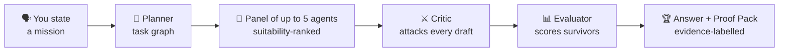

In plain words: a small server runs on your own machine and holds your data, your keys (encrypted), your roster, and your history. The terminal harness and the web UI both talk to that server — never to us. When work runs, the server calls your connected model, through the connection you made, and records what happened: the plan, the drafts, the criticism, the scores, the spend. There is no AgentQon cloud in the middle, because there is no AgentQon cloud.

## 📦 Install

**Requirements:** Node.js ≥ 18 and **Python 3.12 exactly** (the protected payload is compiled for 3.12; setup checks and tells you in plain words if anything is missing).

```sh
npm install -g agentqon
agentqon
```

The first run installs the platform into `~/.agentqon`, starts the local server, and opens your workspace. First time ever, the connect screen is the first thing you see — connect a model there, on the main screen, no hunting through settings.

**Updating** — always in this order:

```sh
agentqon stop
npm install -g agentqon@latest
agentqon setup
agentqon
```

Platform walkthroughs: [Installation guide](docs/installation.md).

## 🚀 Quick start

```sh
agentqon                                  # set up, start, open the UI, chat
agentqon run "Compare pricing strategies for a subscription coffee brand"
agentqon agents                           # who's on the roster, suitability-ranked
agentqon skills                           # browse the skill library
agentqon skills extended                  # the optional Extended Library pack
agentqon arena "Write a launch tweet for a smart lamp"   # blind duel — you judge
agentqon proof <mission-id>               # the evidence behind a result
agentqon doctor                           # health checklist
```

**Connect a model first** (one-time): a local model server on your machine, or an API key — the only two kinds there are. Full guide: [Connecting models](docs/connecting-models.md).

## ⌨️ Commands

| Command | What it does |
|---|---|
| `agentqon` | Set up (first run), start the local server, open the UI, chat |
| `agentqon run <mission…>` | Run one mission and watch the phases live |
| `agentqon setup` | Install/refresh the bundled platform in `~/.agentqon` |
| `agentqon start` / `stop` / `status` | Manage the local server |
| `agentqon serve` | Run the local server in the foreground |
| `agentqon open` / `logs` | Open the web UI / tail the server log |
| `agentqon agents` | Suitability-ranked agents |
| `agentqon skills` | Browse and search the skill library |
| `agentqon skills extended` | The Extended Library: status, or install/remove the optional signed pack |
| `agentqon stats` | Performance ledger + arena leaderboard |
| `agentqon missions` | Recent missions |
| `agentqon proof <mission-id>` | Evidence labels + save the proof pack |
| `agentqon arena <task…>` | Blind agent duel — you pick the winner |
| `agentqon schedules` | Recurring missions |
| `agentqon simulate <mission-id>` | Run a mission's strategies in a model world |
| `agentqon login [--server URL]` | Point the CLI at a hosted AgentQon |
| `agentqon logout` / `whoami` / `use-local` | Identity and mode |
| `agentqon doctor` | Styled health checklist |
| `agentqon update` | How to update |

Full reference: [Command guide](docs/commands.md).

## 📚 Guides and tutorials

Start with the **[docs index](docs/README.md)** — every guide, in the order you'd want them.

<details>
<summary><strong>📚 All 13 guides and tutorials</strong></summary>
<br>

| Guide | What's inside |
|---|---|
| [Installation](docs/installation.md) | Every platform, updates, uninstall, environment switches |
| [Getting started](docs/getting-started.md) | Zero to your first critic-verified mission |
| [Connecting models](docs/connecting-models.md) | The two connection kinds — local server or API key — plus presets, custom headers and model combos |
| [Your first mission](docs/first-mission.md) | A full walkthrough with an example brief, step by step |
| [Agent sessions](docs/agent-sessions.md) | Tool-using agents: tools, approvals, workspaces, the claim guards |
| [Skills](docs/skills.md) | How automatic retrieval works, and what pins do |
| [Model self-test](docs/model-self-test.md) | Proving which of your models actually answer |
| [Society simulation](docs/society.md) | The simulated room: sizes, cost, and what the output does and does not mean |
| [Commands](docs/commands.md) | The full CLI and in-chat slash-command reference |
| [AgentQon as a brain](docs/brain.md) | Wire your own external agent to AgentQon with one scoped key and one POST |
| [WhatsApp & Telegram](docs/whatsapp-and-telegram.md) | Missions from your phone, with the platforms' real limitations stated honestly |
| [Living in simulations](docs/evolve-in-simulations.md) | Let an agent practise, compete and evolve in simulation worlds |
| [Troubleshooting & FAQ](docs/troubleshooting.md) | Ports, Python, rate limits, "model not connected", data locations |

</details>

## ❓ FAQ

<details>
<summary><strong>Is it really free?</strong></summary>
<br>
Yes — MIT-licensed, no paid tier, no trial clock, nothing to unlock. The only money that can ever move is between you and a model provider you choose — and with a free local model, even that is zero. AgentQon shows every run's model cost as a footnote.
</details>

<details>
<summary><strong>Do I need an account?</strong></summary>
<br>
No. There is no AgentQon account, no signup, no activation step. Install it, connect a model, and work — your data lives on your machine, in <code>~/.agentqon/data</code>.
</details>

<details>
<summary><strong>Which models can I use — do I have to pay for one?</strong></summary>
<br>
No payment needed. Two connection kinds, and only two: a <strong>free local model</strong> on your own computer (localhost — Ollama, LM Studio, llama.cpp), which costs nothing to run; or <strong>BYOK</strong> — an API key from a provider you already have, billed by that provider at their rates. Full guide: <a href="docs/connecting-models.md">Connecting models</a>.
</details>

<details>
<summary><strong>Does my work leave my computer?</strong></summary>
<br>
Only to the model you connect — and with a local model, nothing leaves at all. There is no AgentQon cloud in the middle: missions, keys and settings stay in <code>~/.agentqon/data</code>, with keys in an envelope-encrypted vault.
</details>

More answers in [Troubleshooting & FAQ](docs/troubleshooting.md).

## 🗺️ Roadmap

Kept deliberately short and honest: the local product is the product. Later, a hosted option and team features may follow for people who want AgentQon on a server with shared workspaces. No dates are promised, and nothing on this page depends on them.

## 🤝 Support and contact

- **Help with the product:** [SUPPORT.md](SUPPORT.md) — where to ask, what to include, and how security reports work.
- **Bugs and feature requests:** GitHub Issues on this repository.
- **Creator and business contact:** bussiness.agentqon@gmail.com — write directly for reviews, features, and business questions.
- **Security reports:** see [SECURITY.md](SECURITY.md) — report privately, never in a public issue.
- **Contributing:** documentation fixes and guides are welcome — see [CONTRIBUTING.md](CONTRIBUTING.md).

## About this repository

This repository is AgentQon's public home — product documentation, guides and release notes. AgentQon itself is distributed as the [`agentqon` npm package](https://www.npmjs.com/package/agentqon); the one-line install above is all you need.

## ⚖️ Honest limits

- **A local install cannot be made literally untouchable by its own machine's owner.** Shield guarantees package integrity, encrypted data at rest, and resistance to outside attackers — it cannot, and does not claim to, stop the person whose computer it is.
- **Your results are bounded by the connected model.** AgentQon's panel, critic and checks organise a model's work; they cannot give a small model a big model's judgement. Free local models are a fine start; demanding missions reward a stronger model.
- **Simulated numbers are estimates, never predictions** — in simulation worlds and in the society room alike. They are labelled that way on every surface that shows them.
- **The interface is English.** The work itself is not: the connected model answers in whatever language it speaks, so missions and chats run in your language today — only the buttons and labels are English.

## 🏁 Put it to the panel.

One command between you and a panel that plans, checks its own work, and finishes the job:

```sh
npm install -g agentqon
agentqon
```

Free on localhost · your own API key (BYOK) · completely free · no account, no signup · one-command install · private by design · no per-seat pricing.

npm:
https://www.npmjs.com/package/agentqon

GitHub:
https://github.com/adynrisy/agentqon

New here? [Getting started](docs/getting-started.md) takes you to your first mission in about five minutes.

## License

MIT © 2026 Zohaib Khan

<p align="center">
  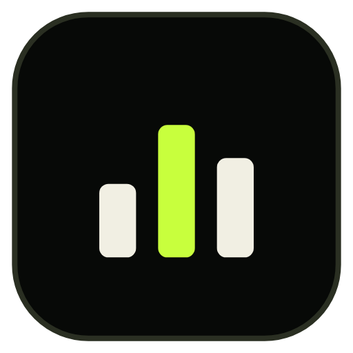
  <br>
  <sub>AgentQon — built by Zohaib Khan · <a href="https://www.npmjs.com/package/agentqon">npm</a> · <a href="docs/getting-started.md">Get started</a></sub>
</p>
