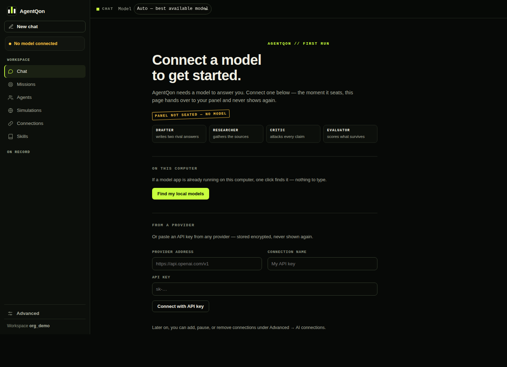

# Connecting models

AgentQon has **no built-in model and no mock mode**. Work runs on the
model you connect (BYOK or a free local model) — and if none is
connected, work refuses with a plain "no model connected" message
instead of inventing output.

There are exactly **two kinds of connection**. That is the whole
design, on purpose:

## Kind 1 — A local model server

A model running on your own machine. No API key, no account, and with
a fully local server, nothing leaves your computer at all.

AgentQon **auto-detects** the common local servers on its first run —
Ollama (port 11434), LM Studio (1234), llama.cpp (8080), and local
router apps (20128) — and says so on the connect screen. If yours is
already running when you first launch, you may find the model
connected before you've done anything.

To add one by hand: **Connections → Add**, choose *Local model
server*, give its address (for example `http://127.0.0.1:11434`).

Best for: free everyday work, privacy, offline use.

## Kind 2 — An API key (BYOK)

Any hosted provider or gateway that speaks the OpenAI-style API. Paste
your key once; it is stored in AgentQon's **envelope-encrypted vault**
on your machine — never in plain text, and sent nowhere except the
provider you named.

To add one: **Connections → Add**, choose *API key*, name the
provider's address, paste the key, and sync — the connection's models
appear in the catalog, ready to seat.

Best for: the strongest hosted models. Your provider bills you at
their rates; AgentQon charges nothing and adds nothing.

  
   First run ever: the connect screen is the landing page. Once you have connected once, you land on the panel instead — a saved connection that is down shows as "Not connected" on the panel, never as a fresh start.

## Which should I choose?

| | Local server | API key (BYOK) |
|---|---|---|
| Cost | Free | Your provider's rates |
| Privacy | Nothing leaves your machine | Prompts go to your provider |
| Strength | Bounded by your hardware | The best hosted models |
| Setup | Install a local server once | Paste a key |

Most people end up with one of each: local for everyday work, a key
for the missions that deserve a stronger model. Connections can be
switched per mission — or left on **Auto**, and pinned per chat when
it matters.

## For scripts and servers

The same two kinds can be declared by environment before starting
AgentQon — base URL, key, and model name — which is how containers
and hosted (accounts-mode) deployments are wired. The kinds do not
change; only who fills the form in.

## Checking the connection

- **Web UI:** the sidebar shows the seated model and its state —
  Connected, or Not connected, in plain words.
- **Terminal:** `agentqon doctor` or `agentqon status`.
- **Proof, not claims:** run the [model self-test](model-self-test.md).
  A configured-but-unreachable endpoint counts as **not connected** —
  AgentQon will never pretend a dead endpoint answered.

## If a model call fails

A connected model whose call fails makes the work fail **loudly** —
you see the failure and its reason in plain words, never a silently
substituted template answer. Check the address, the key, and the
model name; run the self-test; then re-run.
