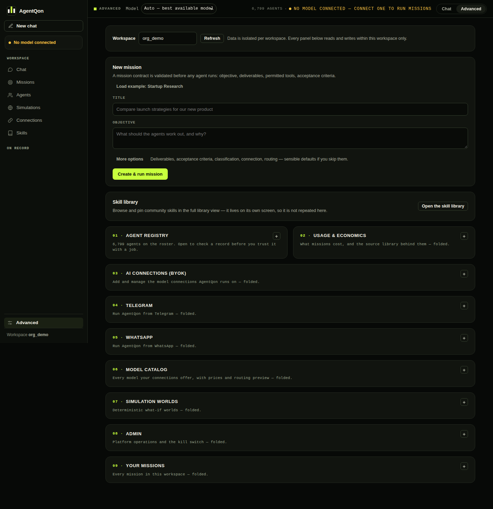

# Your first mission — a full walkthrough

A mission is a job you hand to the panel: a goal in plain words. This
walkthrough runs one real mission end to end, so you can see what each
stage does and what you get back.

**Before you start:** AgentQon installed and a model connected
([Connecting models](connecting-models.md)). If no model is connected,
the mission will refuse — honestly, in plain words — instead of
inventing an answer.

<p align="center">
  
  <br><sub>Where a mission starts: the contract form in Advanced, validated before any agent runs.</sub>
</p>

## The example brief

We will use a brief with a real decision inside it:

> **Compare two onboarding flows for a small invoicing app — a 3-step
> guided setup vs. a single-page form — and recommend one. Our users
> are freelancers, most sign up on phones, and half never finish
> setup today.**

A good brief names three things: **the decision**, **who it is for**,
and **what is going wrong today**. You do not need all three — the
panel will work with a single sentence — but each one you add sharpens
the answer.

## Step 1 — State the mission

In the web UI, switch the composer to **Mission** and paste the brief.
Or in the terminal:

```sh
agentqon run "Compare two onboarding flows for a small invoicing app — a 3-step guided setup vs. a single-page form — and recommend one. Users are freelancers, most sign up on phones, and half never finish setup today."
```

## Step 2 — Watch the panel work

The mission moves through stages, and you can watch each one:

1. **Planning** — the planner breaks the brief into tasks (compare
   the flows, weigh the phone experience, judge the drop-off problem,
   recommend).
2. **Panel seated** — up to five specialists are picked by measured
   suitability for these tasks — not the same five every time. For
   this brief expect product, UX, and research profiles.
3. **Drafting** — the panel members write competing answers in
   parallel. They genuinely compete: different recommendations are
   normal and welcome.
4. **Critic** — every draft is attacked: unsupported claims, ignored
   constraints (did anyone forget the phones?), easy answers that
   dodge the drop-off problem.
5. **Evaluating** — the survivors are scored. The best-scored draft
   becomes your answer; the scores stay visible.

While a mission runs, the composer stays free — you can chat, or even
start a second mission.

## Step 3 — Read the answer like a verdict

The answer arrives as more than text:

- **The recommendation itself**, written by the winning draft.
- **Evidence labels** — the claims in the answer carry the evidence
  behind them, so you can tell a supported claim from a bare opinion.
- **What the critic found** — the weaknesses that were caught, and in
  drafts that lost, the weaknesses that beat them.
- **The cost footnote** — what the run spent on your model, recorded
  as plain accounting.

## Step 4 — Save the Proof Pack

```sh
agentqon proof <mission-id>
```

The Proof Pack is the whole trail as one file: the answer, the
evidence, the criticism, the scores. Keep it with the decision it
informed — months later, "why did we choose the guided setup?" has a
one-file answer.

## Step 5 — Optional: run the world

On the finished mission, **Run the world** seats a simulated room of
agents who react to your recommendation — supporters, sceptics, and
the undecided, arguing over a few rounds. It is a way to feel how a
decision might land before it lands. It is a **simulated estimate,
never a prediction** — read the [society guide](society.md) before
leaning on it.

## Making the next mission better

- **Sharper brief, sharper answer.** Add the constraint you actually
  care about ("must work one-handed", "budget under $500").
- **Pin a model** for the run if one of yours is clearly stronger —
  or leave it on Auto.
- **Check the roster.** `agentqon agents` shows who keeps winning
  work like yours; the ledger behind it is earned, not assigned.

Next: [Agent sessions](agent-sessions.md) — when the work needs
tools, not just thought.
