# Model self-test — prove which models actually answer

A provider's catalog can list a model that no longer exists, a key
can be quietly dead, a free tier can be throttled to silence. The
catalog will still tell you everything is fine. **Listing is not
answering** — so AgentQon checks.

## What it does

Open the **Model catalog** card and press **Test all**. The harness
sends one tiny real request — a single-token completion — to **every
model on every connection**, including the built-in platform route,
and stamps each one:

- **WORKING** — it answered, with the time it took.
- **NOT WORKING** — with the reason in plain words:
  - the key was refused (sign-in failed),
  - the model was not found (the provider no longer offers it),
  - the provider said "slow down" (rate limit),
  - the request timed out,
  - the provider itself is down or unreachable.

A running counter shows progress ("Testing models… X of Y done") and
the summary at the end says it in one line: **"X of Y models
working."**

  
   The self-test, drawn in motion — every model stamped before it is trusted. Why it exists, in one real catch: the catalog listed a model as fine; the probe found it gone.

## Honest rules of the test

- **One run at a time.** Pressing Test all while a run is going shows
  you that run's progress instead of starting a second one.
- **A cap, stated out loud.** At most 40 models per connection are
  probed in one run. If a connection carries more, the results say so
  in plain words — the untested remainder is never silently implied
  to be fine.
- **A WORKING stamp is a moment, not a promise.** It proves the model
  answered *that* request, *then*. A provider can still throttle you
  mid-mission an hour later — when it does, the mission says so
  plainly, and the self-test is how you check the ground truth again.
- **Your connections are yours.** On a hosted server, your self-test
  covers your connections only; another account's results are not
  visible to you, and yours are not visible to them.

## When to run it

- Right after connecting a new provider or pasting a new key.
- When missions start failing with model errors.
- After a provider announces changes, or a free tier resets.

It costs almost nothing — one token per model — and it replaces
guessing with a stamp.
