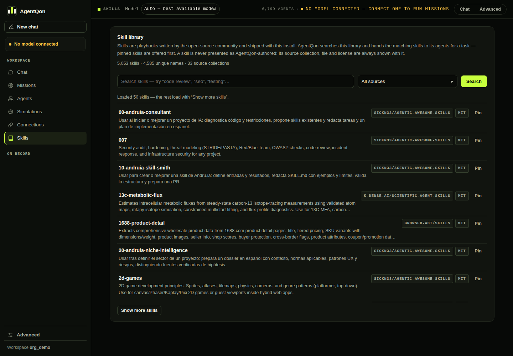

# Skills — packaged know-how, pulled in automatically

A **skill** is a packaged method: a procedure, a checklist, a way of
doing a kind of work well — pricing analysis, code review, research
triangulation, hundreds more. Agents are the *who*; skills are the
*how*. AgentQon ships a library of **5,053 skills**, every one under
an AgentQon name, and the important part is that **you never have to
go and fetch them**: the harness retrieves them for each task on its
own.

  
   The Skills browser — totals, source collections, and search, one click from the main screen.

## How retrieval works

When a chat session or a mission starts, the task text is matched
against the library by a fast full-text index. Two floors keep the
match honest:

- a **relevance floor** — a skill must score above a minimum, and
- a **coverage floor** — it must cover at least half the task's key
  terms.

Only the **top 3** matches are taken, and their combined text is
capped (12,000 characters) so skills sharpen the work instead of
flooding it. The selected skills are handed to the agent as reference
material for that task — clearly marked as reference, never as
instructions from you.

What this feels like in practice: ask for a pricing comparison and
the panel quietly works with a pricing-method skill open beside it.
Ask about something the library has nothing real for, and nothing is
injected — a weak match is treated as no match.

## Pins: the skills you trust most

Pin a skill and it is always considered first for matching work.
Pins are **yours** — stored per account, never shared across accounts
on a hosted server, and a pinned skill still has to fit the task;
pinning promotes, it does not force irrelevant material into a run.

## Browsing the library

- **Web UI:** the Skills browser (screenshot above) — search, filter
  by collection, read any skill in full, pin it.
- **Terminal:** `agentqon skills` — counts, collections, search, and
  full text of any skill by its id.

## Reading a skill before you rely on it

Skills are reference text written to be read. Before pinning one for
work that matters, open it: the browser shows the whole skill, not a
summary. If a skill's method is wrong for your world, your instruction
in the task always outranks it — skills advise the agent; you command
it.
