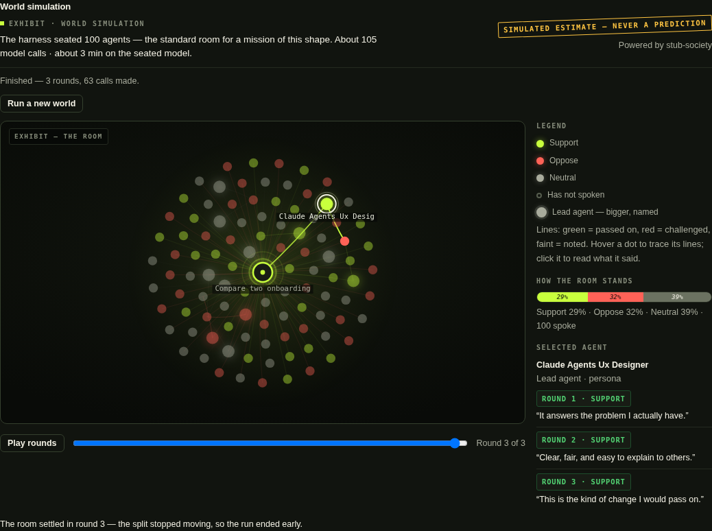

# Society simulation — watch a room react

A mission gives you the panel's verdict. The **society simulation**
answers a different question: *how might people take it?* After a
mission finishes, you can seat a simulated room of agents, hand them
the result, and watch them react to it — and to each other — over
several rounds.

Everything on this page comes with the label the product itself
carries on every society screen: **SIMULATED ESTIMATE — never a
prediction.** Read the last section before you read anything into a
result.

  
   The room: the mission at the centre; leads drawn larger; every node's colour is its stance in the round you are viewing. Click any agent to read its actual lines.

## How you start one

The society is **optional, always** — it never runs on its own:

- In the composer, Mission mode has an **"Also run the world"**
  switch, off by default. Switch it on and the world is seated when
  that mission completes.
- On any finished mission, the **Run the world** button seats one.

Creating a society costs **zero model calls** — the harness sizes and
casts the room, shows you the estimate, and waits. Nothing is spent
until a run actually starts.

## How the harness sizes the room

A **sizer** reads the task — how wide the audience is, how far a
reaction could cascade, the stakes, and how fast your connected model
has proven to be — and picks a room size:

| Tier | Room | For |
|---|---|---|
| Focus | 25 agents | a narrow question, a small audience |
| Reaction | 50 agents | a typical announcement or change |
| **Standard** | **100 agents** | the default room for a mission of ordinary shape |
| Cascade | 250–500 agents | a question whose whole point is how far it spreads |

The size and the sizer's **reason** are written into the output, in
plain words. Rooms above 100 are never started quietly: the estimate
is shown and the run waits for your explicit confirmation. Slow or
throttled models get smaller rooms, and the sizer says why.

## How a run works

- **Leads think individually** — a dozen or so agents with distinct
  personas, each answering for itself.
- **The crowd sits at tables** — most agents react in small mixed
  groups, the way crowds actually form opinions: table by table, not
  one voice at a time. Tables are dealt mixed stances on purpose.
- Each agent's reaction is small and structured: a stance, a
  strength, an action (share it, challenge it, note it, ignore it),
  and one line in its own words.
- A rolling summary carries the room's state from round to round, and
  the run **stops early when the room settles** — when the stance
  split barely moves between rounds, you are told it converged, and
  in which round.
- An agent whose call fails is counted, out loud, as **did not
  respond**. The run completes around the gaps and reports them; a
  room is never silently padded with invented reactions.

## Reading the graph

- The **mission node** sits at the centre. Agents orbit it; leads are
  larger and named.
- **Colour is stance at the selected round** — lime support, red
  oppose, grey neutral, hollow for an agent who has not spoken.
- **Lines between nodes** are reactions: who passed the idea on, who
  challenged whom. Lines are coloured by kind.
- The **round scrubber** and **Play rounds** replay the talk — watch
  positions harden, soften, or flip as rounds pass. The stance-split
  bar beside the graph moves with the round you are viewing.
- **Click any agent** to read its recorded lines, round by round,
  word for word. The graph is drawn from the recorded event list and
  nothing else — what you see is what was actually said.
- If a run's event record is very large, the screen tells you the
  earliest record is what is shown; late lines are never fabricated
  to fill the gap.

## What the output means — and what it does not

The output is a **World simulation** section beside the mission's
own **simple agentic output**: the stance split per round, the lines
each side actually said, whether the room converged, and how many
agents never responded — stamped with the model that powered it, the
room size, and the sizer's reason.

It **does** tell you: how a plausible crowd, built from personas and
played by your model, pushes on an idea — where it catches, where it
bounces off, which objection keeps coming back.

It **does not** tell you: how real people will react. It is a
simulated estimate, produced by a model playing roles — a thinking
tool for pressure-testing a message, never a prediction and never
evidence about the real world. If a decision is expensive, the room
is where you rehearse your arguments, not where you settle them.
