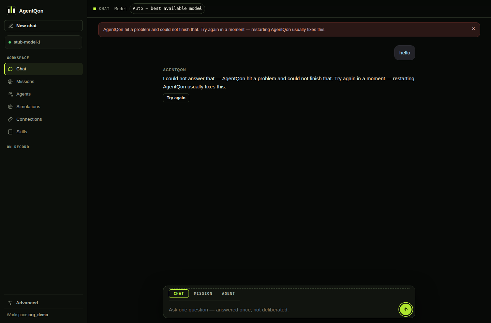

# Troubleshooting & FAQ

<p align="center">
  
  <br><sub>What an AgentQon error looks like: plain words, what to do next, and a way back — never a code or a stack trace.</sub>
</p>

## "Model not connected"

The most common first-run state — and a deliberate one. AgentQon has no
mock mode, so missions wait until a real model is connected. Fixes, in
order of ease:

1. **Ollama running?** `ollama pull qwen2.5`, then `agentqon doctor` —
   the model line should turn green.
2. **BYOK key added?** Web UI → Connections. Check the base URL and
   model name for typos.
3. **Env endpoint set?** The three `AGENTQON_LLM_*` variables must be
   set in the shell that starts AgentQon (see
   [Connecting models](connecting-models.md)).
4. **Endpoint actually alive?** A configured-but-unreachable endpoint
   counts as not connected — by design.

## The server didn't start / port busy

AgentQon starts on port 8000 and **automatically takes the next free
port** if it's taken. `agentqon status` shows the real port, and
`agentqon open` always goes to the right place. `agentqon logs` shows
the server log if startup failed for another reason.

## Python errors on first run

AgentQon's current release needs **Python 3.12 exactly** and builds its
own environment in `~/.agentqon/venv`. The Shield-protected payload is
compiled for 3.12, so if your machine offers 3.11, 3.13 or no Python at
all, setup stops with a message naming the version it found and the one
it needs. Install 3.12 (Windows: `winget install Python.Python.3.12`;
macOS: `brew install python@3.12`), **close and reopen your terminal** so
the new Python is on the path, then run:

```sh
agentqon setup
```

If an earlier install already failed part-way (for example a Shield
integrity error), use `agentqon setup --repair` instead — it restores
the payload from the installed package and rotates the local credentials.

Setup verifies **every** required library imports cleanly in the
environment and says so; `agentqon doctor` includes a Libraries line if
you want to re-check later.

## "Shield: the bundled payload failed integrity verification"

That refusal is Shield working as designed — it will not run a bundle
whose files don't match the signed release manifest. Do not use that
copy; repair it from the current release instead:

```sh
npm install -g agentqon@latest
agentqon setup --repair
agentqon
```

Known cause on Windows: releases up to 20.2.0 bundled 88 roster files
whose names contain characters Windows forbids (colons, a stray control
character), so those files could never be created on disk and the
manifest check correctly failed. **Fixed in 20.2.1** — the filenames are
sanitized and the manifest re-signed. If you still see this error on
20.2.1 or later, reinstall from npm as above and report the exact error
text with your version (`agentqon --version`).

## "The provider said slow down" — rate limits (429)

Free tiers throttle. When a provider answers 429, AgentQon does not
pretend and does not immediately die: the mission waits the time the
provider asked for and retries, and the step shows, in plain words,
that it is waiting on the provider. Three honest consequences:

- **Missions on a tight free tier run slower in throttled minutes** —
  that is the provider's limit, not a hang. The status line tells you
  which one it is.
- If throttling outlasts the retry budget, the mission ends FAILED
  with the reason. Re-run it when the tier resets, or seat a second
  connection and spread the work.
- The [model self-test](model-self-test.md) shows a rate-limit stamp
  per model, so you can see a throttled model before a mission finds
  it the hard way.

## A model is connected but missions still fail

"Connected" means AgentQon can see the endpoint. It does not prove
the model answers. Run the **self-test** (Model catalog → Test all):
each model is stamped WORKING or NOT WORKING with the reason — a dead
key, a model the provider removed, a timeout. Fix the reason it
names; if a model stamps WORKING and missions still fail, include the
self-test result and `agentqon doctor` output in your report.

## Updating didn't take — the old version still answers

A server left running from an older install keeps serving the old
code. Always update in this exact order:

```sh
agentqon stop
npm install -g agentqon@latest
agentqon setup
agentqon
```

The stop matters most: it is the difference between "the new version
is installed" and "the new version is what is running". `agentqon
status` and the version line in `agentqon doctor` tell you which one
is live.

## A mission failed — where's the answer?

There isn't one, and that's the guarantee working: a mission whose model
call fails ends **FAILED** with the reason attached (check
`agentqon missions` or the mission in the UI). AgentQon would rather show
you a failure than a fabricated success.

## Where is my data?

Everything lives in `~/.agentqon/`:

| Path | Contents |
|---|---|
| `~/.agentqon/data` | Missions, settings, encrypted vault |
| `~/.agentqon/venv` | The platform's Python environment |
| `~/.agentqon/server/<version>` | The installed platform |
| `~/.agentqon/config.json` | CLI config (owner-only permissions) |

Back up the `data` folder and you've backed up AgentQon.

## FAQ

**Is AgentQon free?**
The software is MIT-licensed and free. You bring the model: a local
Ollama model costs nothing; hosted providers charge their own rates, and
AgentQon shows every run's cost as a footnote before it can surprise you.

**Does my data leave my machine?**
Only to the model you connected. With Ollama, nothing leaves at all.

**How is this different from a chatbot wrapper?**
A wrapper gives you one model's first draft. AgentQon runs a
suitability-picked panel of specialist agents, attacks their drafts with
a critic, scores the survivors, tracks every agent's record, and hands
you the evidence trail (the Proof Pack) with the answer.

**Can multiple people use one deployment?**
Yes — hosted deployments support accounts with owner/admin/member/viewer
roles and per-tenant isolation of missions, keys and usage.

**Why does the version list on npm show a `0.0.0-stage`?**
That was the placeholder created by npm's staged-publishing flow during
the first release. `latest` points at the real release; the placeholder
is harmless history.

**I found a bug / want a feature.**
Open an issue in this repository with your `agentqon doctor` output and
what you expected to happen.
